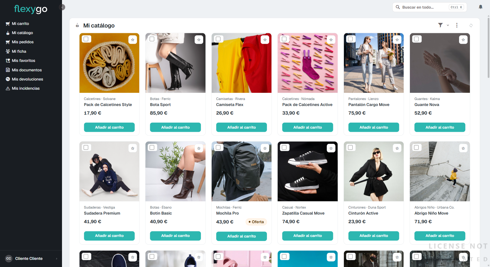
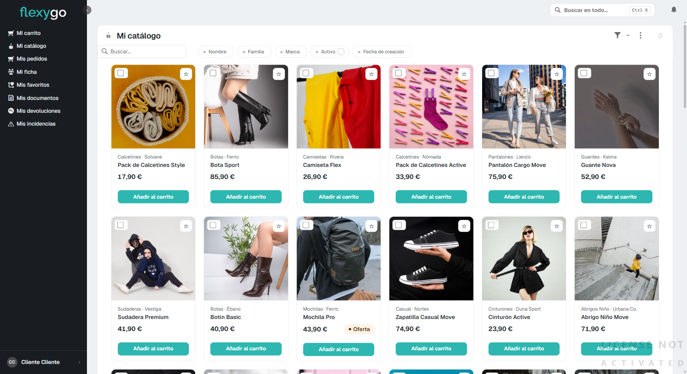

# Consultar el catálogo y buscar productos

## 1. Abre "Mi catálogo"

En el menú lateral, pulsa **Mi catálogo**. Verás todos los productos disponibles en tarjetas, seis por fila, con su familia, marca, nombre y precio.

Cada tarjeta tiene:
- Una **estrella** arriba a la derecha, para marcarlo como favorito.
- Una etiqueta **Oferta** cuando el producto tiene un precio rebajado.
- El botón **Añadir al carrito**.

## 2. Busca un producto

Pulsa el icono del embudo (filtro), arriba a la derecha del listado, y elige **Buscar productos**. Aparece una caja de búsqueda y varios filtros rápidos: por Nombre, Familia, Marca, si está Activo, y por fecha de creación.

Escribe en la caja de búsqueda el nombre o parte del nombre del producto que buscas (por ejemplo, "bota") y el listado se actualiza solo, sin que tengas que pulsar nada más.

## 3. Combina varios filtros

Puedes combinar la búsqueda por texto con cualquiera de los filtros (Familia, Marca...) para acotar más. Por ejemplo: Familia = "Calzado" y Marca = "Ferric" te mostraría solo ese calzado de esa marca.

---

Desde aquí puedes seguir a:
- [Marcar productos como favoritos](02-marcar-favoritos.md)
- [Hacer un pedido](03-realizar-pedido.md)
