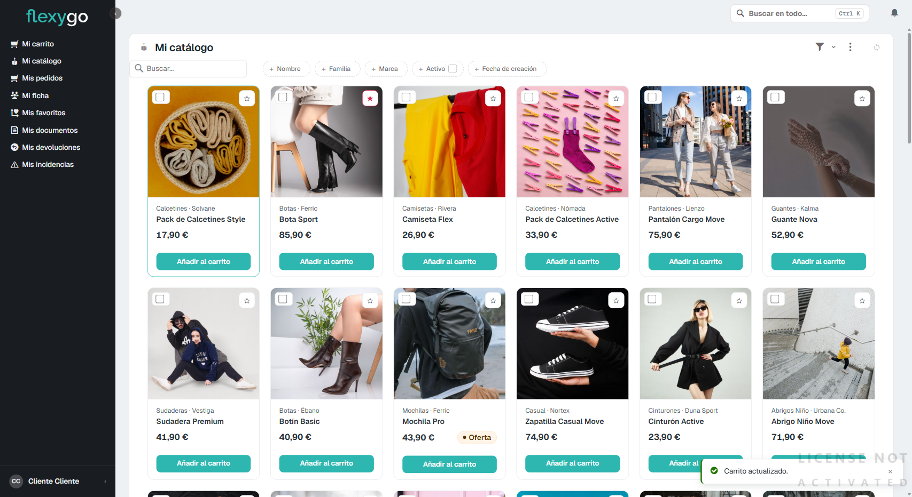
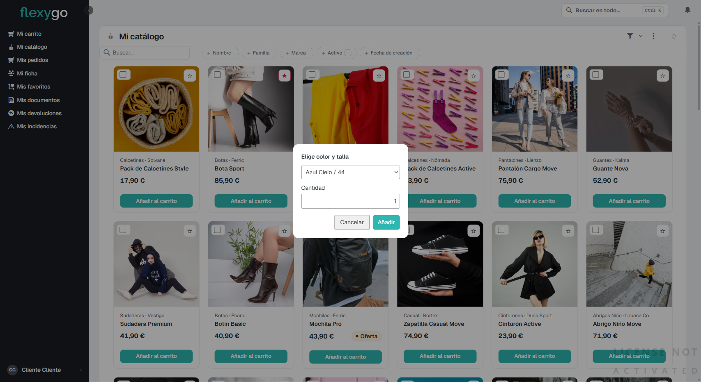
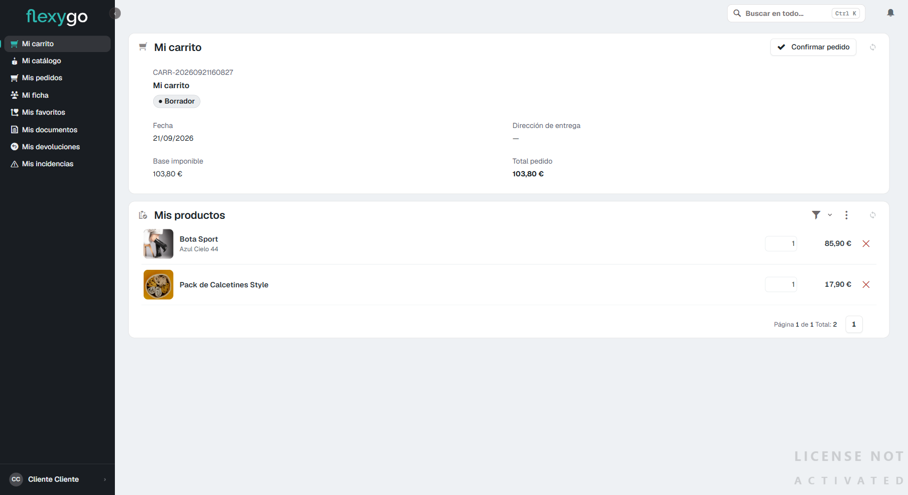
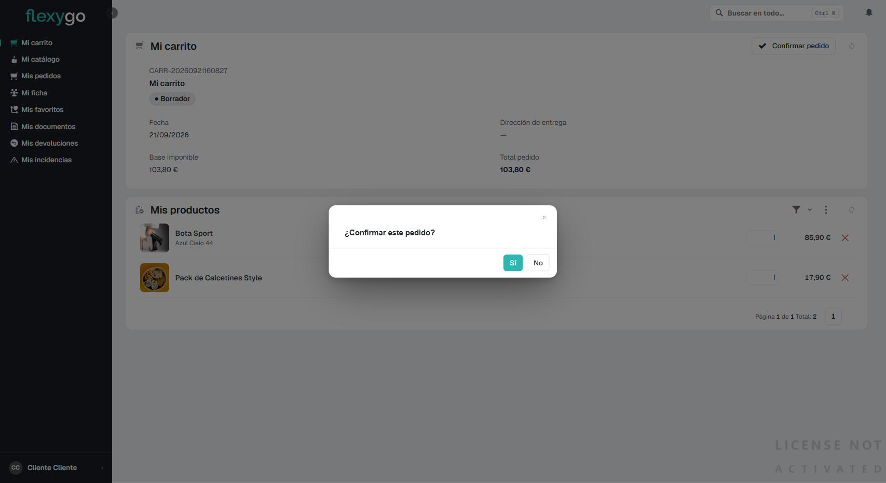
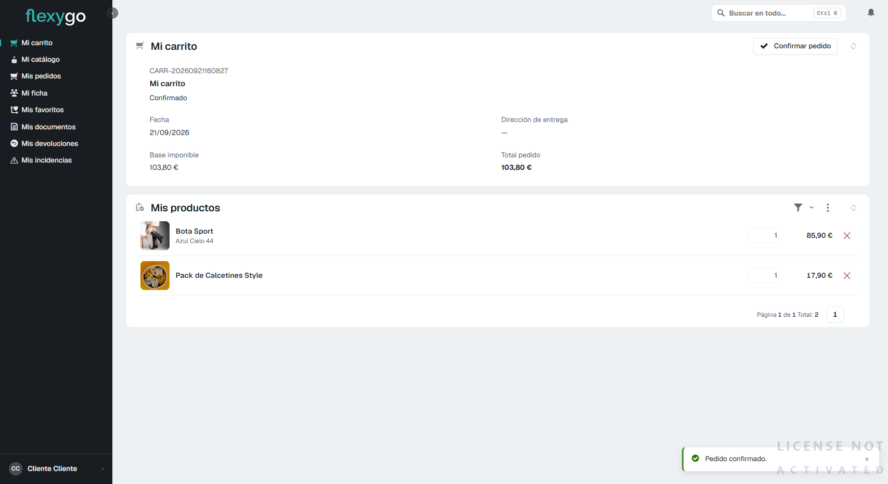

# Hacer un pedido

## 1. Añade productos desde el catálogo

Entra en **Mi catálogo** y localiza el producto que quieres comprar.

Pulsa **Añadir al carrito** en la tarjeta del producto.

- **Si el producto no tiene tallas ni colores**, se añade directamente y aparece un aviso "Carrito actualizado." en la esquina inferior derecha.

  

- **Si el producto tiene variantes** (talla, color), se abre antes una ventana para que elijas cuál quieres y la cantidad:

  

  Elige la combinación en el desplegable, ajusta la **Cantidad** si quieres más de una unidad, y pulsa **Añadir**.

Repite este paso con todos los productos que quieras comprar.

## 2. Revisa "Mi carrito"

Entra en **Mi carrito**, en el menú lateral. Verás el detalle de tu pedido en borrador: cada línea con su producto, la variante elegida, el precio y un campo para cambiar la cantidad o quitar la línea (icono ✕).

Arriba a la derecha tienes el total del pedido y el botón **Confirmar pedido**.

## 3. Confirma el pedido

Pulsa **Confirmar pedido**. Te pedirá que lo confirmes una segunda vez:

Pulsa **Sí**. El pedido pasa de "Borrador" a "Confirmado" y aparece el aviso "Pedido confirmado.":

A partir de aquí, tu pedido pasará por los siguientes estados hasta llegarte — puedes seguir su progreso en [Consultar tus pedidos y su seguimiento](04-seguimiento-pedido.md).

---

Desde aquí puedes seguir a:
- [Consultar tus pedidos y su seguimiento](04-seguimiento-pedido.md)
- [Descargar tus documentos](05-descargar-documentos.md)
