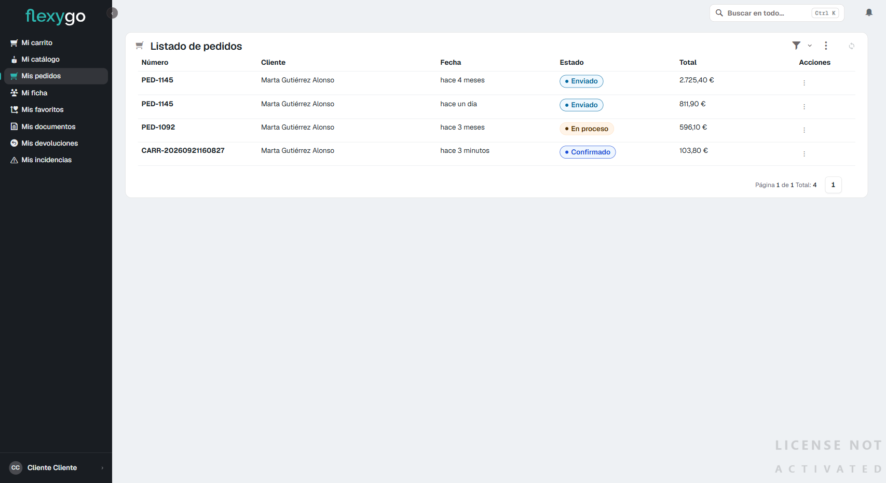

# Consultar tus pedidos y su seguimiento

## 1. Abre "Mis pedidos"

En el menú lateral, pulsa **Mis pedidos**. Verás el listado completo de tus pedidos: número, fecha, estado (con un color distinto para cada uno) y total.

## 2. Abre el detalle de un pedido

Pulsa sobre cualquier fila del listado. Se abre la ficha de ese pedido, con un indicador de progreso que muestra en qué punto está: Borrador → Confirmado → En proceso → Enviado → Entregado. El paso ya completado se marca con un check, el paso actual con un punto relleno, y los que faltan con un círculo vacío.

Debajo del indicador tienes:

- **Detalles**: cliente, fecha del pedido y forma de pago.
- **Envío**: transportista, número de seguimiento, fecha estimada de entrega y el enlace para seguir el envío en la web del transportista. Estos datos aparecen en cuanto el pedido se pone en camino — hasta entonces se muestran vacíos (—).
- **Líneas del pedido**: cada producto pedido, con su cantidad y precio. Desde aquí también puedes [solicitar una devolución](06-realizar-devolucion.md) de una línea concreta.

Arriba de la ficha tienes además el botón **Generar PDF**, para [descargar el pedido en PDF](05-descargar-documentos.md), y **Crear incidencia** si necesitas [abrir una incidencia](07-abrir-incidencia.md) sobre ese pedido.

---

Desde aquí puedes seguir a:
- [Solicitar una devolución](06-realizar-devolucion.md)
- [Abrir una incidencia](07-abrir-incidencia.md)
- [Descargar tus documentos](05-descargar-documentos.md)
