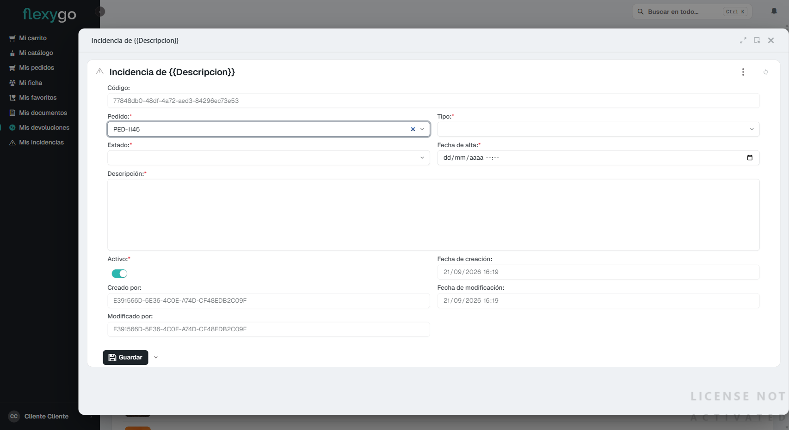
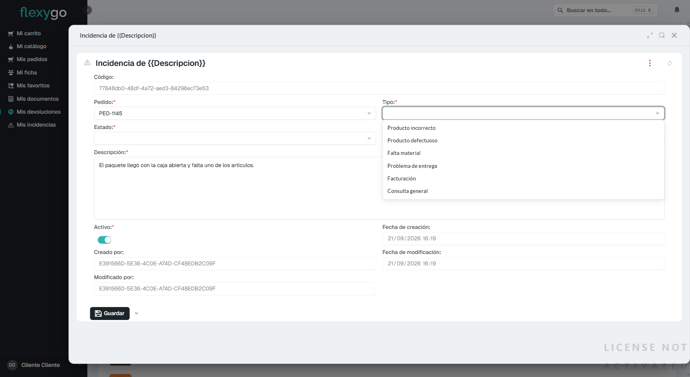
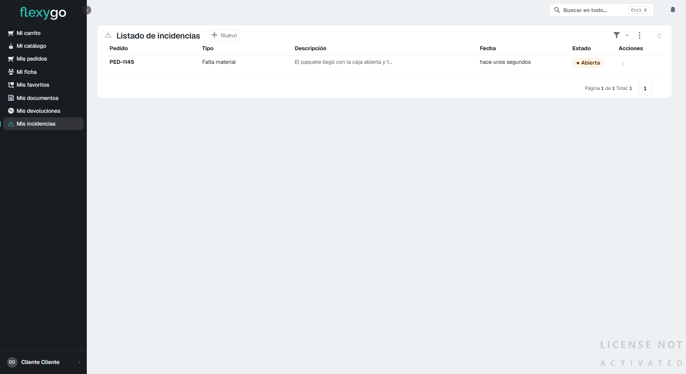

# Abrir una incidencia

Usa una incidencia para avisar de un problema con un pedido que no es exactamente una devolución: un producto incorrecto, algo defectuoso, que falte material, un problema con la entrega, una duda de facturación o cualquier consulta general.

## 1. Abre el pedido

Entra en **Mis pedidos** y abre el pedido sobre el que quieres avisar. Justo debajo del estado del pedido tienes el botón **Crear incidencia**.

## 2. Rellena el formulario

Al pulsarlo se abre una ventana con el **Pedido** ya relleno.

Completa:

- **Tipo**: elige entre Producto incorrecto, Producto defectuoso, Falta material, Problema de entrega, Facturación o Consulta general.

  

- **Estado**: normalmente la dejarás en "Abierta".
- **Fecha de alta**: la fecha de hoy.
- **Descripción**: explica el problema con el detalle que necesites — es el campo que va a leer quien la atienda.

## 3. Guarda la incidencia

Pulsa **Guardar**. La incidencia queda registrada y aparece de inmediato en **Mis incidencias**, con su tipo, descripción y estado "Abierta".

## 4. Sigue tus incidencias

Entra en **Mis incidencias** cuando quieras para ver el estado de cada una: Abierta o Cerrada.

---

Desde aquí puedes seguir a:
- [Consultar tus pedidos y su seguimiento](04-seguimiento-pedido.md)
- [Solicitar una devolución](06-realizar-devolucion.md)
