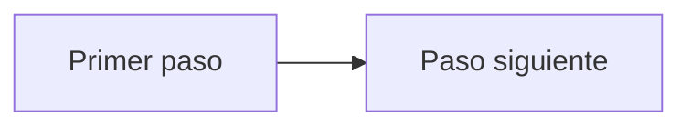

# flxCatalog — incorporación

<!-- flexygo:generated:start -->
## El proyecto de un vistazo

_Lo mantiene al día el servidor de Flexygo. Todo lo que queda fuera de estas dos marcas es vuestro._

- **Qué es, su alcance, modelo de datos y roles:** [.flexygo/memory/project.md](.flexygo/memory/project.md)
- **Decisiones del proyecto:** [.flexygo/memory/decisions.md](.flexygo/memory/decisions.md)
- **Desarrollos:** el plan de cada uno, con sus decisiones al lado:
  - [carrito-pedidos](.flexygo/developments/carrito-pedidos/plan.md) — terminado
  - [catalogo-demo](.flexygo/developments/catalogo-demo/plan.md) — terminado
  - [correcciones-rol-cliente](.flexygo/developments/correcciones-rol-cliente/plan.md) — terminado
  - [notificaciones-comunicacion](.flexygo/developments/notificaciones-comunicacion/plan.md) — terminado
  - [pendientes-cliente-admin](.flexygo/developments/pendientes-cliente-admin/plan.md) — terminado
  - [portal-clientes](.flexygo/developments/portal-clientes/plan.md) — terminado
  - [presupuestos-postventa](.flexygo/developments/presupuestos-postventa/plan.md) — terminado
- **Usarlo desde fuera (WebAPI, asistentes de IA):** [API.md](API.md)
- **Cómo va ahora mismo:** `/flx-status`, o el panel de Flexygo (`/flexygo`).
<!-- flexygo:generated:end -->

<!-- flexygo:flow -->
## Cómo fluye el negocio

_Se escribe con el usuario, y solo lo escriben personas: los pasos en orden, los procesos que hacen avanzar cada uno y quién lo hace. No se puede deducir de las tablas._

## Las pantallas principales

_Las cinco que abre primero quien llega, y para qué sirve cada una._

## Por dónde empezar

_Qué abrir primero y qué comando lanzar._
