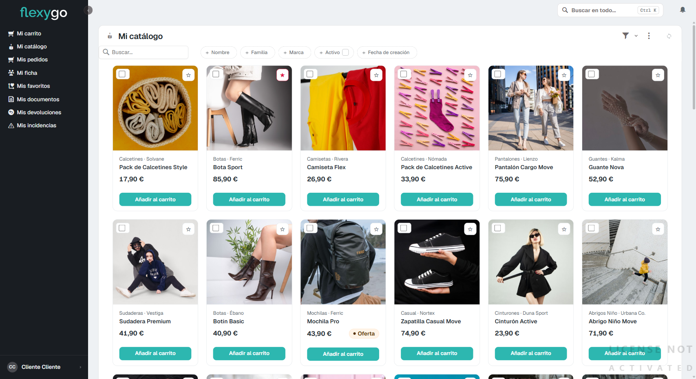
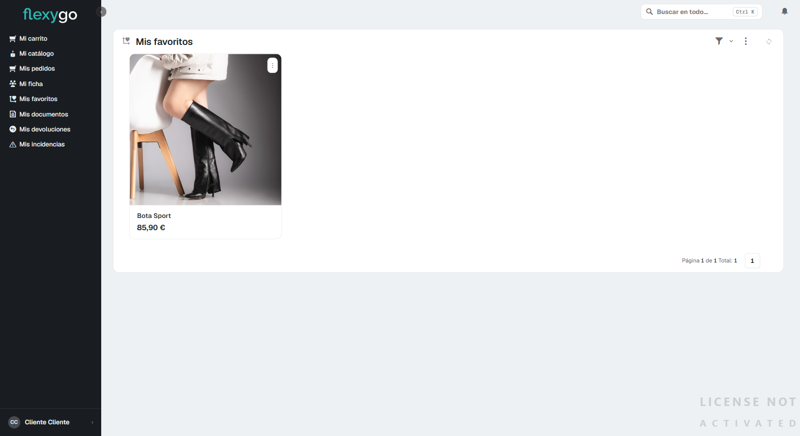

# Marcar productos como favoritos

## 1. Ve a "Mi catálogo"

Desde el menú lateral, entra en **Mi catálogo**. Cada tarjeta de producto tiene una estrella vacía (☆) en la esquina superior derecha de la imagen.

## 2. Pulsa la estrella del producto que te interese

Al pulsarla, la estrella se rellena de color y el producto queda marcado como favorito. No hace falta guardar nada más ni confirmar: es inmediato.

Para quitar un favorito, vuelve a pulsar la misma estrella — se vacía otra vez.

## 3. Consulta tus favoritos

Entra en **Mis favoritos**, en el menú lateral. Ahí aparecen, en el mismo formato de tarjeta, todos los productos que has marcado.

---

Desde aquí puedes seguir a:
- [Hacer un pedido](03-realizar-pedido.md)
- [Consultar el catálogo y buscar productos](01-consultar-catalogo.md)
