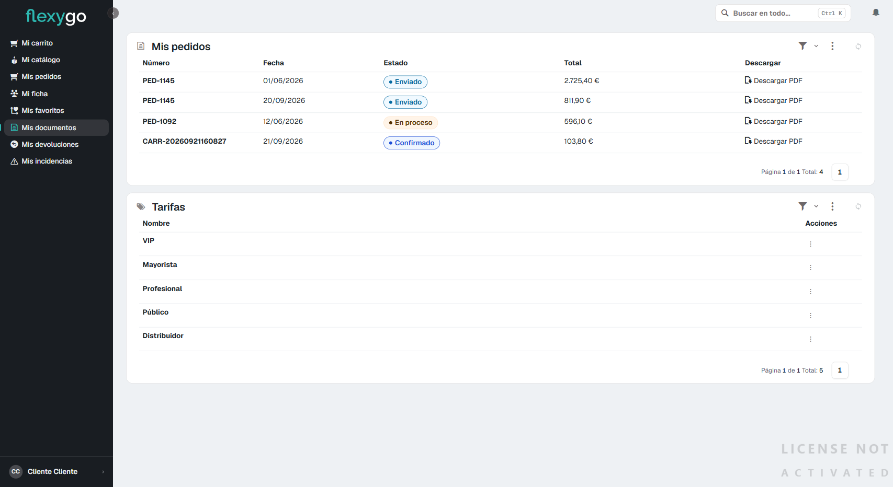

# Descargar tus documentos

## 1. Abre "Mis documentos"

En el menú lateral, pulsa **Mis documentos**. La pantalla tiene dos bloques:

- **Mis pedidos**, arriba: el listado completo de tus pedidos con su número, fecha, estado y total.
- **Tarifas**, debajo: las tarifas de precios disponibles, como referencia.

## 2. Descarga el PDF de un pedido

En la columna **Descargar**, a la derecha de cada pedido, pulsa **Descargar PDF**. El navegador descarga el documento con el detalle de ese pedido.

También puedes generar el mismo PDF desde la propia ficha del pedido: entra en [Mis pedidos](04-seguimiento-pedido.md), abre el pedido que quieras, y pulsa **Generar PDF** arriba de la ficha.

## 3. Consulta las tarifas

El bloque **Tarifas**, debajo del listado de pedidos, te muestra las tarifas de precios que existen, como referencia de precios.

---

Desde aquí puedes seguir a:
- [Consultar tus pedidos y su seguimiento](04-seguimiento-pedido.md)
