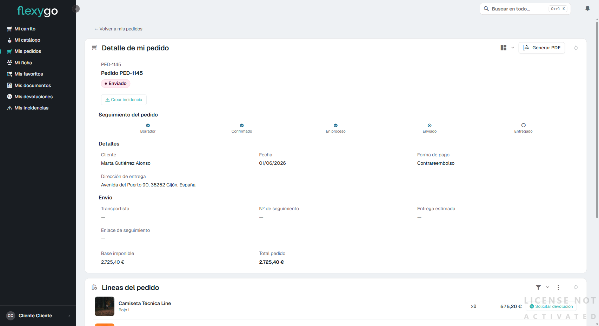
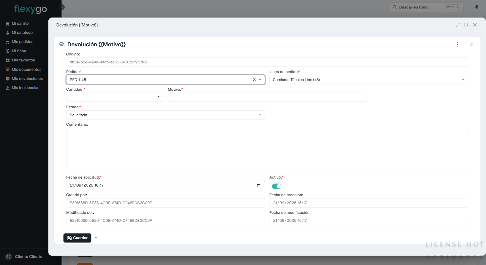
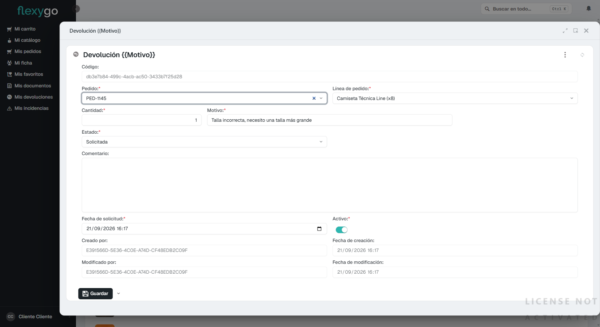
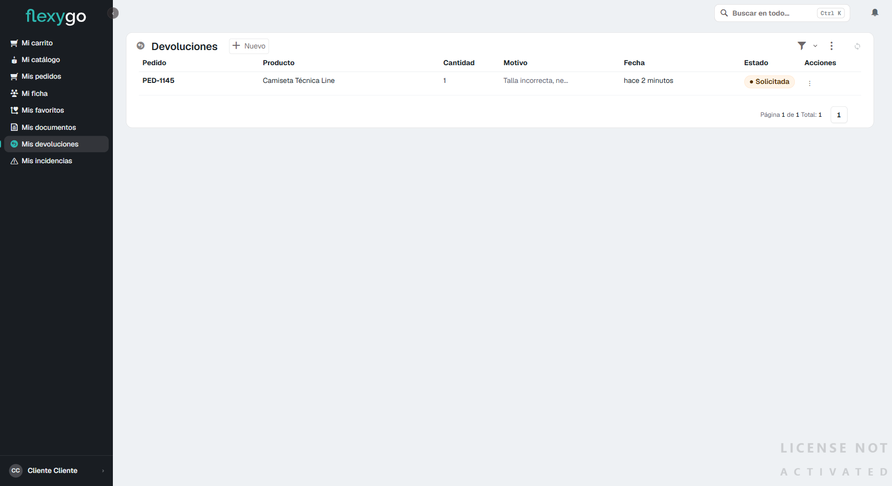

# Solicitar una devolución

## 1. Abre el pedido y localiza la línea a devolver

Entra en **Mis pedidos**, abre el pedido que contiene el producto que quieres devolver, y baja hasta el bloque **Líneas del pedido**. Cada línea tiene, a la derecha, un botón **Solicitar devolución**.

## 2. Rellena el formulario de devolución

Al pulsarlo se abre una ventana con el **Pedido** y la **Línea de pedido** ya rellenados — no tienes que buscarlos ni escribirlos.

Completa:

- **Cantidad**: cuántas unidades de esa línea quieres devolver.
- **Motivo**: por qué la devuelves (obligatorio) — por ejemplo, "Talla incorrecta".
- **Comentario**: cualquier detalle adicional, opcional.

El **Estado** empieza siempre en "Solicitada".

## 3. Guarda la solicitud

Pulsa **Guardar**. La devolución queda registrada y aparece de inmediato en **Mis devoluciones**, con el motivo y el estado "Solicitada".

## 4. Sigue el estado de tus devoluciones

Entra en **Mis devoluciones** cuando quieras para ver en qué punto está: Solicitada → En revisión → Aceptada o Rechazada → Abonada (si procede el reembolso).

---

Desde aquí puedes seguir a:
- [Consultar tus pedidos y su seguimiento](04-seguimiento-pedido.md)
- [Abrir una incidencia](07-abrir-incidencia.md)
