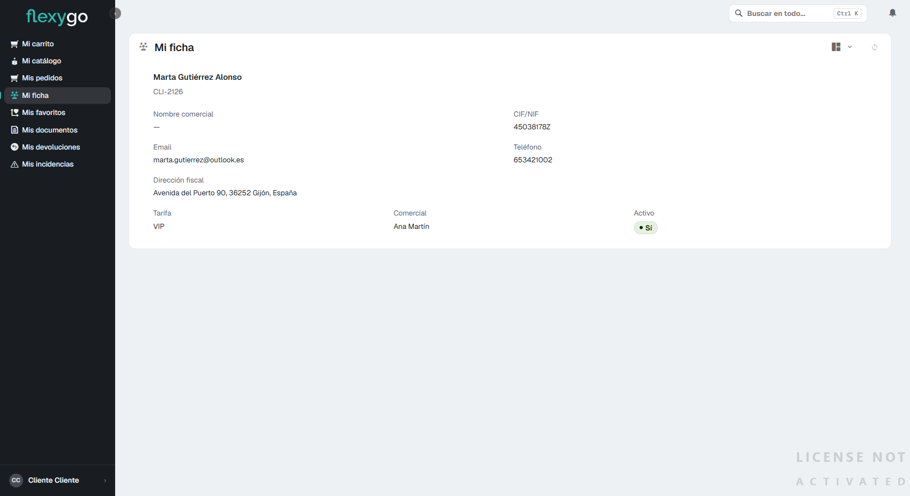

# Consultar tu ficha de cliente

## 1. Abre "Mi ficha"

En el menú lateral, pulsa **Mi ficha**. Verás tus propios datos de cliente: razón social, código de cliente, nombre comercial, CIF/NIF, email, teléfono, dirección fiscal, la tarifa que tienes asignada, tu comercial de referencia y si tu cuenta está activa.

Esta pantalla es tu propia información — nadie más la ve, y tú no ves la de otros clientes.

Si necesitas corregir algún dato (dirección, teléfono, email...), ponte en contacto con tu comercial o con el equipo de atención al cliente.

---

Desde aquí puedes volver a:
- [Inicio](index.md)
